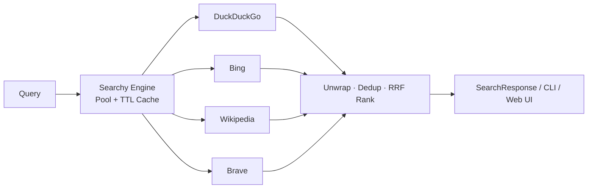

<div align="center">
  <h1>✦ msearchy</h1>
  <p><strong>Parallel Python Metasearch</strong></p>
  <p>Query DuckDuckGo, Bing, Wikipedia, and Brave at once and get one clean schema for text, image, and video results.</p>
  <p>
    <a href="https://github.com/Adarshukumar/msearchy">
      
    </a>
    <a href="https://github.com/Adarshukumar/">
      
    </a>
    
    
  </p>
  <p>
    <a href="#installation">Installation</a>
    &nbsp;·&nbsp;
    <a href="#usage">Usage</a>
    &nbsp;·&nbsp;
    <a href="#cli">CLI</a>
    &nbsp;·&nbsp;
    <a href="#web-explorer">Web Explorer</a>
    &nbsp;·&nbsp;
    <a href="https://github.com/Adarshukumar/msearchy/issues">Issues</a>
  </p>
</div>

---

## Overview

`msearchy` queries multiple search engines concurrently on a pooled `httpx.AsyncClient` and merges the results into typed Pydantic models. Each engine runs inside its own timeout and error boundary, so a slow or failing provider never breaks the rest of the response.

Before results return, `msearchy` unwraps tracking redirects (Bing `ck/a`, DuckDuckGo `/l/?uddg=`, and Google `/url?q=`), removes tracking query parameters (`utm_*`, `fbclid`, `gclid`), merges duplicate URLs, and ranks overlapping hits higher with Reciprocal Rank Fusion.



## Engines

| Engine | Text | Images | Videos | Notes |
| :--- | :---: | :---: | :---: | :--- |
| `duckduckgo` | Yes | Yes | Yes | Lite HTML with ad filtering and `/l/?uddg=` decoding; cached `vqd` shared across images and videos |
| `bing` | Yes | Yes | Yes | Decodes `ck/a` base64url links; reads image dimensions and video durations |
| `wikipedia` | Yes | Yes | No | MediaWiki search API and Wikimedia Commons bitmaps |
| `brave` | Yes | No | No | Extracts titles cleanly without breadcrumb prefixes |

## Installation

```bash
pip install msearchy
```

Optional extras:

```bash
pip install "msearchy[http2]"   # HTTP/2 support via h2
pip install -e ".[dev]"         # Local development + tests
```

## Usage

### Synchronous

```python
from searchy import SearchCategory, Searchy

client = Searchy(timeout=8.0, cache_ttl=60.0)

res = client.search("python asyncio", category=SearchCategory.TEXT, limit_per_provider=5)
print(res.unique_results, res.total_results, res.provider_counts)

bundle = client.search_all("mountain", limit_per_provider=3)
print(bundle.text.unique_results, bundle.images.unique_results, bundle.videos.unique_results)
```

### Asynchronous

Open `Searchy` with `async with` to reuse one keep-alive connection pool across queries, or stream engines as they finish with `astream()`:

```python
import asyncio
from searchy import SearchCategory, Searchy


async def main() -> None:
    async with Searchy(timeout=6.0, cache_ttl=60.0) as client:
        res = await client.asearch("postgresql indexing", SearchCategory.TEXT, limit_per_provider=5)
        for item in res.results:
            print(f"{item.score:.4f}  {item.providers_matched}  {item.title} -> {item.url}")

        async for report, items in client.astream("rust web server", SearchCategory.TEXT):
            print(report.provider, f"{report.elapsed_ms} ms", len(items))


asyncio.run(main())
```

### Output schema

```json
{
  "query": "python asyncio",
  "category": "text",
  "total_results": 10,
  "unique_results": 8,
  "elapsed_ms": 184.2,
  "cache_hit": false,
  "provider_counts": { "duckduckgo": 3, "bing": 3, "wikipedia": 2, "brave": 2 },
  "results": [
    {
      "category": "text",
      "provider": "duckduckgo",
      "title": "asyncio — Asynchronous I/O",
      "url": "https://docs.python.org/3/library/asyncio.html",
      "domain": "docs.python.org",
      "score": 0.032787,
      "providers_matched": ["duckduckgo", "bing"]
    }
  ]
}
```

## CLI

```bash
# Framed terminal panels across all categories
searchy "python asyncio" --category all --limit 5

# Filter providers and export JSON or Markdown
searchy "linux namespaces" -p duckduckgo wikipedia --format markdown
searchy "fastapi" --json

# Stream each engine as soon as it responds
searchy "sqlite wal mode" --stream
```

Formats: `pretty` (default), `compact`, `json`, and `markdown`. Use `--no-dedup`, `--no-rank`, `--timeout`, or `--no-color` to control output and behavior.

## Web explorer

Start the built-in local interface (stdlib HTTP server, no extra dependencies):

```bash
searchy --serve --host 0.0.0.0 --port 8080
# or
searchy-web --port 8080
```

Includes category tabs, provider toggles, latency bars, JSON and Markdown views, a URL unwrapper tool, and a local demo mode for testing offline.

## Custom providers

Subclass `BaseProvider` and register it on any `Searchy` client:

```python
import httpx
from searchy import BaseProvider, SearchCategory, SearchResult, Searchy


class CustomProvider(BaseProvider):
    name = "custom"
    supports_text = True

    async def search_text(
        self, client: httpx.AsyncClient, query: str, limit: int = 10
    ) -> list[SearchResult]:
        resp = await self._request(client, "GET", "https://example.com/api", params={"q": query})
        return [
            SearchResult(
                category=SearchCategory.TEXT,
                provider=self.name,
                title=row["title"],
                url=row["url"],
                snippet=row.get("snippet") or "",
            )
            for row in resp.json()[:limit]
        ]


client = Searchy()
client.register_provider(CustomProvider())
```

## Development

```bash
pytest -v
ruff check searchy tests
mypy searchy
```

---

<div align="center">
  <sub>Maintained by <a href="https://github.com/Adarshukumar/">Adarsh Kumar</a> · MIT License</sub>
</div>
